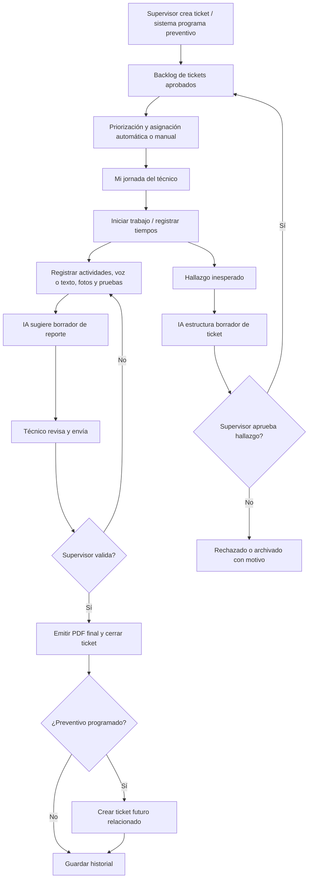

# DZONE — Contexto integral del proyecto

> **Documento de continuidad del proyecto**  
> Fecha de consolidación: 23 de octubre de 2026  
> Estado: definición funcional + demo inicial de escritorio en Python  
> Destino inicial: Windows (`.exe`); expansión prevista a web y móvil

## 1. Resumen ejecutivo

**Dzone** es un sistema para gestionar el mantenimiento técnico mediante **tickets, planificación de tareas diarias, asignación de técnicos, seguimiento de tiempos, hallazgos de campo, aprobación del supervisor, generación de reportes PDF y programación de mantenimientos preventivos**.

La meta es **reducir trabajo administrativo y evitar la pérdida de documentación**, especialmente cuando los técnicos realizan muchas intervenciones. El técnico debe poder registrar el trabajo con texto o voz, adjuntar evidencias y solicitar el cierre; el supervisor debe poder revisar rápidamente lo realizado, aprobar hallazgos y controlar la operación.

El uso de **IA local/offline** es un elemento estratégico: transcribir voz, convertir narraciones en borradores de reportes, extraer hallazgos, sugerir prioridades y apoyar análisis históricos. Sin embargo, **la IA no debe aprobar, cerrar ni inventar hechos por sí sola**. Los estados y permisos deben ser controlados por reglas de negocio auditables.

**Alcance inicial del MVP:** una aplicación de escritorio para Windows. Se ha elegido **Python para desarrollar la demo rápidamente**, antes de decidir una arquitectura de producción; antes se evaluaron Java y C#/.NET con Avalonia.

---

## 2. Problema que buscamos resolver

En operaciones de mantenimiento:

- Se crean solicitudes o incidencias, pero no siempre queda claro quién las atiende y cuándo.
- Algunos trabajos urgentes desplazan otros pendientes sin una planificación visible.
- Los técnicos olvidan documentar intervenciones o escribir informes consume mucho tiempo.
- Los hallazgos incidentales (por ejemplo, una válvula desgastada) no siempre se convierten en una solicitud formal.
- Es difícil saber cuánto duró un equipo funcionando correctamente después de una reparación.
- Se repiten fallas sin un seguimiento histórico que permita investigarlas.
- Los supervisores necesitan validar los trabajos sin reconstruir toda la información manualmente.

**La prioridad de Dzone es el ciclo de vida del ticket y el trabajo diario**, no un inventario patrimonial completo. El registro de equipos será un catálogo auxiliar para vincular cada intervención a un activo.

## 3. Objetivos funcionales

1. Crear tickets por incidente, hallazgo o mantenimiento programado.
2. Mantener un tablero visible con estados y prioridades.
3. Asignar tareas manualmente o automáticamente a técnicos disponibles.
4. Mostrar a cada técnico su jornada priorizada.
5. Registrar inicio, avance, finalización, duración y evidencias de la intervención.
6. Generar un **reporte técnico en PDF** por intervención aprobada.
7. Convertir observaciones encontradas por un técnico en **borradores de nuevos tickets pendientes de aprobación**.
8. Cerrar formalmente los tickets con revisión de un supervisor.
9. Crear tareas preventivas futuras solo cuando corresponda una regla o decisión autorizada.
10. Detectar reincidencias y analizar el tiempo entre reparaciones y nuevas fallas.
11. Incorporar voz e IA offline para disminuir el tiempo de registro.
12. Preparar la evolución hacia un sistema multiusuario con web y aplicación móvil.

## 4. Roles y permisos

### 4.1 Supervisor / administrador

- Crear, clasificar y priorizar tickets.
- Definir trabajos, responsables y fechas objetivo.
- Configurar reglas de asignación y prioridades.
- Aprobar o rechazar hallazgos reportados por técnicos.
- Revisar evidencias e informes.
- Validar el cierre de trabajos y generar o aprobar el PDF final.
- Programar o ajustar preventivos.
- Ver pendientes, tiempos, reincidencias y desempeño de procesos.
- Reabrir trabajos o solicitar correcciones dejando constancia de quién y por qué.

### 4.2 Técnico

- Consultar tareas asignadas y prioridades del día.
- Iniciar, pausar y terminar actividades.
- Registrar trabajos con texto; **más adelante, por voz offline**.
- Adjuntar fotografías, evidencias y observaciones.
- Enviar el reporte para validación.
- Registrar hallazgos inesperados en campo, incluso si no son parte del ticket original.
- Proponer un ticket nuevo **sin incorporarlo al plan de trabajo hasta aprobación**.

### 4.3 Asignador automático del sistema

- Asignar tickets aprobados teniendo en cuenta reglas explícitas.
- Respetar especialidad, disponibilidad, prioridad, carga de trabajo y vencimientos.
- Evitar asignar a personas no disponibles o sin la especialidad necesaria.
- Informar la justificación de cada propuesta de asignación.
- Permitir anulación o modificación por el supervisor.

> **Pendiente:** definir usuarios reales, turnos, especialidades, sedes, calendario y niveles de permisos. La demo actual cambia de rol en pantalla y **no tiene autenticación real**.

---

## 5. Metodología de gestión: Kanban con prácticas de Scrum

Se conversó sobre usar Scrum. Para mantenimiento diario, **Kanban resulta más adecuado como mecanismo operativo**, porque hay incidencias no planificadas y prioridades que pueden cambiar durante el día. Podemos aprovechar prácticas de Scrum sin imponer sprints rígidos a trabajos de emergencia.

**Prácticas recomendadas:**

- **Backlog:** listado ordenado de tickets pendientes y hallazgos aprobados.
- **Planificación diaria:** definir qué trabajos entrarán a la jornada de cada técnico.
- **Tablero Kanban:** ver la situación real de cada ticket.
- **Límites de trabajo simultáneo (WIP):** evitar que un técnico tenga demasiadas tareas abiertas.
- **Revisión diaria breve:** pendientes, bloqueos, urgencias y reasignaciones.
- **Revisión periódica:** estudiar tiempos, recurrencias y oportunidades de prevención.

### 5.1 Estados recomendados del ticket

| Estado | Significado | Responsable habitual |
|---|---|---|
| `Pendiente` | Ticket aprobado, sin asignar | Supervisor / sistema |
| `Asignado` | Tiene técnico responsable y fecha | Supervisor / asignador |
| `En proceso` | Intervención iniciada | Técnico |
| `En validación` | Técnico terminó y entregó reporte/evidencias | Supervisor |
| `Terminado` | Cierre validado y documentado | Supervisor |

**Estado complementario futuro:** `Bloqueado` (falta de material, acceso, permiso o repuesto), con causa registrada. También conviene que los **hallazgos sin aprobar** estén en una bandeja propia, no mezclados con tickets aprobados.

### 5.2 Reglas de transición

- Un hallazgo creado por un técnico es un **borrador**.
- El supervisor aprueba o rechaza el borrador.
- Cuando aprueba, se crea un ticket nuevo en `Pendiente`.
- El asignador o supervisor pasa `Pendiente` a `Asignado`.
- El técnico inicia la atención y pasa a `En proceso`.
- Cuando termina, registra resultados y evidencias y envía a `En validación`.
- El supervisor aprueba el reporte, el sistema emite el PDF y el ticket pasa a `Terminado`.
- Si el reporte no está conforme, vuelve a corrección, registrando el motivo.
- Un ticket cerrado **no se reutiliza** como preventivo: se crea otro relacionado si hay una regla de programación.

---

## 6. Flujo de extremo a extremo



### 6.1 Escenario A: atención normal

1. Existen cinco solicitudes pendientes (por ejemplo, revisar bomba, válvula o tablero).
2. El supervisor define prioridades; el sistema puede sugerirlas.
3. El asignador distribuye los trabajos entre técnicos según disponibilidad y especialidad.
4. El técnico abre **Mi jornada** y ve el orden sugerido.
5. Inicia un trabajo y registra la intervención.
6. Dicta o escribe las actividades realizadas, resultados y pruebas.
7. El sistema prepara un borrador de informe; el técnico lo revisa.
8. Envía a validación.
9. El supervisor acepta o devuelve para corrección.
10. Una vez aceptado, se genera el PDF final y se guarda el historial.

### 6.2 Escenario B: hallazgo nuevo durante una intervención

1. El técnico está revisando una bomba y observa desgaste en una válvula cercana.
2. Registra por voz o texto: «La válvula V-04 presenta desgaste y debe inspeccionarse/reemplazarse».
3. La IA identifica equipo, ubicación, condición y acción propuesta; **si faltan datos, los deja pendientes**.
4. El sistema sugiere una prioridad basada en reglas y contexto; no la confirma automáticamente.
5. Se crea un **borrador de hallazgo**.
6. El técnico revisa y envía.
7. El supervisor ve una bandeja de **Hallazgos por aprobar**, acepta o rechaza.
8. Si acepta, se crea un ticket formal que entra en el backlog y puede asignarse.

### 6.3 Escenario C: mantenimiento correctivo y preventivo

1. Se resuelve una falla prioritaria y se valida el cierre.
2. Si hay una regla de mantenimiento, se agenda un **ticket preventivo nuevo**, ligado al correctivo anterior.
3. Los intervalos podrían ser de 5, 15 o 30 **días laborables**, o por calendario/horas de uso, según el activo.
4. La próxima jornada muestra únicamente lo que corresponde atender por fecha y prioridad.
5. Si surge una nueva falla antes del preventivo, se crea un nuevo incidente y se registra la reincidencia.
6. La IA puede ayudar a detectar patrones, pero **no debe concluir que la reparación anterior fue deficiente solo por haber una nueva falla**.

---

## 7. Tickets, equipos y datos mínimos

### 7.1 Ficha de ticket

- ID único (`TK-0001`, etc.).
- Tipo: correctivo / preventivo / inspección / hallazgo convertido a ticket.
- Título y descripción.
- Equipo o activo asociado.
- Ubicación (vivienda, sector, planta, área, etc.).
- Prioridad y motivo.
- Estado.
- Fecha/hora de creación y fecha objetivo.
- Técnico asignado y supervisor responsable.
- Fechas/horas de asignación, inicio, pausas, envío a revisión y cierre.
- Duración real y tiempo estimado.
- Actividades realizadas, materiales y resultados.
- Evidencias (fotografías, documentos, pruebas).
- Reporte PDF vinculado.
- Historial de eventos y cambios.
- Ticket padre/relacionado, si existe.
- Fecha propuesta de mantenimiento futuro, cuando aplique.

### 7.2 Registro de equipos: auxiliar, no eje principal

- Código único del equipo.
- Nombre / tipo (bomba, válvula, tablero, etc.).
- Ubicación e identificación física.
- Especialidad requerida.
- Estado actual.
- Historial de tickets vinculados.
- Fecha de última intervención y siguiente preventivo.
- Datos adicionales opcionales: fabricante, serie, criticidad, manual y horas de operación.

### 7.3 Reporte técnico PDF

Campos recomendados: código de ticket, equipo, ubicación, fechas, técnico, supervisor, descripción de solicitud, actividades realizadas, materiales, resultados/pruebas, observaciones, evidencias, conclusión del técnico y firmas o constancia de validación según la política definida.

- La **exportación final es PDF**; la IA redacta un borrador editable, no un documento que se aprueba automáticamente.
- Las fotos y otras pruebas deben quedar enlazadas a la intervención.
- No inventar inspecciones, mediciones ni nombres.
- Versionar el reporte si se corrige después del envío.
- Más adelante: firma electrónica/digital según la necesidad legal y operativa real.

---

## 8. Asignación automática y planificación diaria

### 8.1 Primera versión: motor de reglas

Propuesta de factores:

1. Prioridad del ticket.
2. Fecha objetivo y antigüedad.
3. Especialidad y competencias del técnico.
4. Disponibilidad y turno.
5. Cantidad de trabajos activos y tiempo estimado.
6. Ubicación, para evitar desplazamientos innecesarios.
7. Herramientas y repuestos requeridos, si están registrados.
8. Continuidad: preferencia razonable por técnicos que conocen el activo, sin asignación injusta o excesiva.

**La asignación automática es una sugerencia operativa explicable**: supervisor puede reasignar. Emergencias pueden cambiar el orden de la jornada.

### 8.2 Reglas mínimas para una planificación confiable

- No asignar a técnicos fuera de turno o sin especialidad.
- Evitar múltiples trabajos simultáneos incompatibles.
- Mostrar por qué un ticket tiene prioridad.
- Mantener trazabilidad de cualquier reasignación.
- Distinguir **urgencia** de **criticidad del equipo**.
- No agendar automáticamente un preventivo si no hay regla ni autorización.

### 8.3 Papel futuro de la IA en la asignación

La IA podrá sugerir estimaciones de duración y anomalías basadas en historiales suficientes, pero **la versión inicial no requiere entrenar un modelo específico**: empezar con reglas transparentes será más seguro y fácil de probar. Los registros del sistema permitirán análisis más avanzados después.

---

## 9. Métricas y seguimiento histórico

### 9.1 Métricas de tickets

- Pendientes, asignados, en proceso, en validación y terminados.
- Tiempo desde creación hasta asignación.
- Tiempo desde asignación hasta inicio.
- Tiempo efectivo de intervención (sin pausas).
- Tiempo total hasta cierre.
- Tickets vencidos y tiempo de espera de validación.
- Trabajos correctivos vs. preventivos.

### 9.2 Métricas de confiabilidad y reincidencia

- Cantidad de fallas por equipo y por componente.
- Intervalo entre una reparación validada y la siguiente falla.
- Reincidencia antes del próximo mantenimiento preventivo.
- Duración de intervenciones similares.
- Tiempo medio entre fallas (MTBF), **si los datos y el modo de operación lo permiten**.
- Tiempo medio de reparación (MTTR), bien definido para no mezclar espera y ejecución.
- Tendencias de fallas repetidas por sector o tipo de equipo.

**Precaución:** una falla recurrente no prueba negligencia de un técnico. Puede deberse al diseño, desgaste, piezas, operación, ambiente o diagnóstico previo. El sistema debe **alertar para investigar**, no emitir juicios automáticos sobre personas.

---

## 10. Inteligencia artificial offline

### 10.1 Funciones previstas

1. **Voz a texto** del técnico, sin depender de Internet.
2. **Generación de borradores de reportes** en formato estructurado.
3. **Extracción de hallazgos** para proponer tickets nuevos.
4. **Clasificación y prioridad sugerida**, con confirmación o regla explícita.
5. **Consulta de históricos y manuales** mediante búsqueda local/RAG en una fase posterior.
6. **Análisis de tendencias** de reincidencias, tiempos y mantenimiento programado con datos suficientes.

### 10.2 Stack candidato de IA local

- **Ollama**: servicio local que expone una API para modelos de lenguaje.
- **Qwen** u otro LLM compacto: redacción/extracción de información.
- **Whisper.cpp** o un motor equivalente: reconocimiento de voz local.
- Validación por esquemas JSON: convierte la salida de IA en campos verificables.

Es posible ejecutar IA offline **después de descargar e instalar los modelos**. La capacidad real dependerá de RAM, CPU, GPU y tamaño del modelo. No se ha seleccionado aún un modelo definitivo ni se ha comprobado el hardware de los usuarios finales.

### 10.3 Ejemplo del procesamiento de un dictado

**Dictado:** «Hoy cambié dos sellos de la bomba B-102, limpié el filtro y comprobé que funciona normalmente».

**Campos esperados (borrador, no hechos adicionales):**

```json
{
  "equipo": "B-102",
  "actividades": ["Cambio de dos sellos", "Limpieza de filtro"],
  "resultado_reportado": "Funcionamiento normal según el técnico",
  "datos_pendientes": ["Fecha y hora exactas", "Pruebas o mediciones", "Responsable"],
  "requiere_revision": true
}
```

La IA no debe rellenar valores no informados; debe solicitar confirmación de datos críticos.

### 10.4 Internet, sincronización y WhatsApp

- El procesamiento local del modelo puede funcionar sin Internet.
- La API oficial de WhatsApp y el envío por esa plataforma **sí requieren conectividad**, además de integración y permisos apropiados.
- A futuro se podría trabajar offline y sincronizar cuando vuelva la conexión.
- WhatsApp/Telegram son canales opcionales, no dependencias del MVP Windows.

---

## 11. Tecnología propuesta y evolución

### 11.1 Demo actual

| Capa | Tecnología |
|---|---|
| Aplicación de escritorio | Python + Tkinter |
| Base de datos | SQLite local |
| PDF | ReportLab |
| Instalación de dependencias | pip |
| Empaquetado futuro a `.exe` | PyInstaller |
| IA real | **Aún no conectada** |

### 11.2 Opciones consideradas para producción

- **C#/.NET + Avalonia UI:** opción fuerte para escritorio, con posibilidad de reutilizar lógica y partes de interfaz en otras plataformas.
- **C# + WPF:** si el destino fuera exclusivamente Windows.
- **Java + JavaFX:** alternativa técnicamente viable, no descartada.
- **Python + PySide6:** útil para una versión de escritorio más elaborada si decidimos continuar con Python.
- Backend multiusuario futuro: **ASP.NET Core o API equivalente** con **PostgreSQL**.

**Decisión vigente:** validar primero el flujo con Python y no asumir todavía una migración obligatoria a C#. El diseño deberá separar datos, reglas, servicios, interfaz e IA para facilitar cambios posteriores.

### 11.3 Arquitectura modular objetivo

```text
Dzone Windows (interfaz)
  ├─ Tickets / estados / prioridades
  ├─ Jornada y asignaciones
  ├─ Hallazgos y aprobaciones
  ├─ Registro de actividades y evidencias
  ├─ Reportes PDF
  └─ Panel de métricas
        │
        ▼
Servicios de negocio (validaciones y reglas)
  ├─ Motor de asignación
  ├─ Programación de preventivos
  ├─ Auditoría de cambios
  └─ Adaptador de IA local (futuro)
        │
        ├─ SQLite (demo) → PostgreSQL (multiusuario)
        ├─ ReportLab / motor PDF
        └─ Ollama + transcripción offline (futuro)
```

---

## 12. Estado real de los prototipos existentes

### Actualización visual y tickets listos para repetir la prueba

El usuario aclaró que necesita nuevos tickets de ejemplo, no generación de títulos con IA. Se añadió Cargar ejemplos para supervisor: 12 tickets idempotentes, asignados por especialidad/carga solo dentro de ese lote; la base de esta prueba tiene 3 para cada demo1–demo4. No se reemplazan ni asignan otros pendientes existentes.

Se modernizaron tablas, botones, resumen y tarjetas. Se sustituyeron las barras visibles y scrolls internos del Kanban por una página continua con rueda del mouse, incluso fuera de la tabla. No hay movimiento en reposo. Se mantienen controles de texto y cierre fijo de formularios. IA y voz está únicamente en el menú supervisor, con grabación y extracción del técnico dentro del ticket. Las pruebas verifican desplazamiento por eventos, ausencia de barras, detención al soltar la rueda y carga sin duplicados. La captura visual del helper Windows sigue fallando por tiempo de espera; no se afirma revisión por screenshot.

### Actualización: login y nueva prueba limpia

Se reemplazó el cambio de roles por login local: demo0/demo0 para supervisor y demo1/demo1 a demo4/demo4 para técnicos (Mecánica, Eléctrica, Mecánica, General). El menú y los datos se restringen a la sesión; los servicios verifican rol, propietario y vigencia de sesión. Supervisor crea/asigna/valida; técnico inicia, documenta y envía solo sus tickets. Los hallazgos conservan el autor autenticado. Se guardan hashes de contraseña con sal; siguen siendo cuentas públicas de demo, no identidades productivas.

La aplicación normal inicia sin tickets y ya no inserta muestras automáticamente. El reinicio solicitado crea un respaldo de SQLite y archivos antes de limpiar registros de trabajo y recrear usuarios, conservando modelos y configuración. El script es `reset_demo.py --reiniciar`. La distribución con EXE/ZIP debe reconstruirse después de este cambio.

**Resultado:** se reinició la base local con 0 tickets, 0 hallazgos, 0 borradores y 5 usuarios; respaldo en `.respaldos_demo/20261023_110621_398468/`. Pasaron 35 pruebas de reglas, borradores, autenticación/permisos, reinicio y ventanas. El EXE reconstruido pasó la verificación real de login, menú técnico restringido, voz sintética, Qwen3 y PDF (`verificacion_login_ejecutable.json`). Se actualizó el ZIP distribuible.

### Actualización: tercera entrega — decisión de voz e IA local

El usuario confirmó **Qwen3 4B** (no Phi-3) y entrada por **micrófono** para computadores Windows. La distribución prevista es una carpeta con EXE, runtime y modelos, ejecutable en otras máquinas sin Python instalado; no incluye sincronización ni activación por licencia.

Se incorporaron borradores persistentes y versionados, edición antes del envío y vista previa con confirmación explícita. Se conserva el audio, la transcripción original, fuente revisada, extracción y modelo. Qwen clasifica referencias a oraciones: el programa copia el texto original y valida el esquema, sin utilizar prosa generada para los hechos. Los campos ausentes quedan como No informado. El supervisor continúa siendo quien valida el cierre y PDF.

La voz se transcribe localmente con Whisper base multilingüe/faster-whisper; el motor de texto usa llama.cpp CPU y Qwen3-4B-Q4_K_M. La preparación descarga modelos explícitamente y conserva licencias/manifiesto. La inferencia no descarga modelos. Se añadieron `dzone_ai.py`, `dzone_ai_ui.py`, `preparar_ia.py`, `empaquetar_windows.py`, `requirements-ia.txt`, pruebas y guía de distribución. Los estados descritos en apartados anteriores corresponden a la demo inicial y se deben leer junto a estas actualizaciones.

**Verificación real:** se compiló `dist/DzoneDemo/DzoneDemo.exe` con modelos y runtime incluidos. La comprobación del EXE con un audio sintético en español completó transcripción (~3 s), extracción (~9 s), ventanas y PDF. Resultado en `verificacion_ejecutable.json`. El micrófono real no se activó durante las pruebas y falta validar en un segundo equipo Windows. El paquete no incluye las bases ni audios personales del equipo de desarrollo.

### Actualización: primera entrega de estabilización (23 de octubre de 2026)

**Segunda entrega (23 de octubre de 2026):** se incorporó `dzone_views.py` con navegación lateral, inicio operativo con contadores y acciones, jornada en tarjetas, búsqueda y filtros de tickets, bandeja de validaciones y Kanban desplazable sin truncar resultados. El detalle destaca el estado, muestra correcciones y permite consultar el reporte enviado. Se corrigió un error de limpieza que destruía la ventana principal al actualizar/cambiar de rol. El iniciador verifica intérpretes disponibles, incluido el runtime local de Codex como alternativa, y los errores inesperados se registran. Las pruebas en `test_dzone_ui.py` verifican navegación, actualización, formularios, filtros y el flujo completo mediante botones hasta generar un PDF. La captura visual mediante el helper de Windows falló por tiempo de espera, por lo que no se afirma una revisión visual por screenshot. El historial por activo y calendario visual, tiempo efectivo/pausas, autenticación, evidencias almacenadas e IA siguen pendientes.

Se separó la interfaz (`dzone.py`) de las reglas transaccionales (`dzone_services.py`) y del acceso SQLite/PDF (`dzone_core.py`). Se implementaron revisión visible de informes y apertura de evidencia, asignación por especialidad exacta y fecha programada, preventivo desactivado por defecto, motivos obligatorios para correcciones/rechazos, vínculo hallazgo-ticket y eventos de auditoría con actor y fecha. El cierre prepara el PDF antes de confirmar estado y preventivo; los errores ordinarios revierten la operación. La migración conserva los datos anteriores y su programación, sin reconstruir eventos ni fechas de creación desconocidas.

Las pruebas automatizadas están en `test_dzone.py`. No se ha validado visualmente la aplicación ni compilado el EXE en esta entrega. Siguen pendientes el rediseño de vistas, disponibilidad/turnos, pausas y tiempo efectivo, varias evidencias almacenadas, autenticación real e IA/voz. Esta separación mínima permite probar reglas sin añadir infraestructura a la demo.

### 12.1 Demo anterior en Excel

Se creó una prueba inicial de gestión con panel, tickets, equipos y reporte de demostración. Fue útil para definir el concepto, pero el alcance cambió hacia un programa de escritorio.

### 12.2 Demo Python para Windows disponible

**Archivo entregado:** `Dzone_Demo_Python_Windows.zip`.

Contenido verificado del ZIP:

```text
Dzone_Demo_Python/
├── README.md
├── requirements.txt
├── iniciar_windows.bat
└── dzone.py
```

Funciones documentadas e implementadas en la demo:

- Interfaz con Tkinter.
- Roles simulados de supervisor y técnico.
- Tickets con estados operativos.
- Cinco tickets de ejemplo.
- Asignación automática simple por prioridad, especialidad y carga.
- Asignación manual.
- Inicio de trabajo y envío de reporte escrito a validación.
- Validación del supervisor, cierre y generación PDF con ReportLab.
- Creación y aprobación/rechazo de hallazgos.
- Creación de ticket preventivo relacionado para fechas posteriores si corresponde.
- Tablero Kanban e indicadores.
- Persistencia SQLite en el equipo.

**Límites comprobados en el README y código:**

- No es un sistema multiusuario en red.
- No hay login real ni autorización robusta.
- No tiene Ollama conectado ni generación de reportes mediante un LLM.
- No hay reconocimiento de voz offline integrado.
- La prioridad del hallazgo se sugiere por **palabras clave**, no por IA entrenada.
- No se ha implementado firma digital.
- El calendario laboral considera lunes a viernes, **sin feriados regionales**.
- Los archivos de evidencia se referencian por ruta; no se copian/almacenan en un repositorio propio.
- El ZIP contiene código y un iniciador `.bat`; **no incluye todavía un `.exe` compilado**.

No debemos describir estas capacidades futuras como si ya estuvieran listas.

### 12.3 Instalación de la demo en Windows

Requisitos: Windows 10/11, Python 3.10 o superior (con Tkinter) y ReportLab.

```cmd
py -m pip install -r requirements.txt
py dzone.py
```

Alternativamente, abrir `iniciar_windows.bat`.

**Datos persistentes:** `%LOCALAPPDATA%\DzoneDemo\`.

**Empaquetar en `.exe` (desde Windows):**

```cmd
py -m pip install pyinstaller
py -m PyInstaller --noconfirm --onefile --windowed --name DzoneDemo --collect-all reportlab dzone.py
```

El ejecutable aparecería en `dist\DzoneDemo.exe` si la compilación termina correctamente. Este procedimiento está documentado, pero no se afirma que ya se haya compilado o probado en el Windows del usuario.

---

## 13. Fases de desarrollo propuestas

### Fase 1 — MVP operativo Windows

- Estabilizar demo Python.
- Tickets CRUD, búsqueda, filtros y detalle.
- Roles reales básicos.
- Estados y auditoría de cambios.
- Jornada de técnicos y asignación manual/automática explicable.
- Reporte editable y PDF consistente.
- Hallazgos con aprobación.
- Calendario de preventivos y vínculos entre tickets.

**Criterio de aceptación:** gestionar un ticket desde alta hasta PDF final, incluyendo la autorización del supervisor y la persistencia después de cerrar el programa.

### Fase 2 — IA local y voz

- Descargar y ejecutar modelo LLM local.
- Transcripción offline de voz.
- Estructuración de narraciones en JSON.
- Reporte sugerido por IA y editable.
- Hallazgo por voz → borrador → aprobación → ticket.
- Evaluar exactitud, consumo de recursos y latencia en hardware real.

**Criterio de aceptación:** un técnico dicta una intervención y el sistema propone un borrador correcto, editable y trazable sin conexión a Internet.

### Fase 3 — Mejoras de planificación y confiabilidad

- Disponibilidad, calendarios, turnos y feriados configurables.
- Asignación ponderada y replanificación ante urgencias.
- Alertas por repetición de fallas.
- Tiempos efectivos vs. esperas.
- Indicadores por activo, ubicación y tipo de mantenimiento.
- Configuración explícita de reglas preventivas.

### Fase 4 — Multiusuario, web y móvil

- Backend API con autenticación y roles.
- PostgreSQL centralizado.
- Sincronización, trazabilidad y soporte de conflictos.
- Aplicación web para supervisores.
- Aplicación móvil para técnicos con cámara, micrófono y posible modo offline.
- Integración opcional WhatsApp/Telegram para notificaciones o reportes.

---

## 14. Decisiones de diseño que debemos preservar

1. **El ticket es el centro del sistema**; los equipos se usan principalmente para contextualizarlo.
2. El flujo de trabajo es Kanban con planificación diaria, inspirado en prácticas ágiles.
3. La asignación puede ser automática, pero debe ser explicable y controlable.
4. Los hallazgos nuevos **no entran directamente al trabajo aprobado**: requieren revisión de supervisor.
5. El técnico debe escribir lo mínimo posible; voz + IA es la dirección del producto.
6. El reporte final es **PDF**, con revisión humana previa.
7. El supervisor es quien valida el cierre formal.
8. Los preventivos futuros son **nuevos tickets vinculados**, no el mismo ticket reutilizado.
9. Registrar tiempos y fallas recurrentes es tan importante como registrar un cierre.
10. La IA sugiere y estructura; **no fabrica mediciones ni atribuye culpabilidad**.
11. Primero Windows + Python para validar el concepto; después definir plataforma productiva.
12. El procesamiento offline es deseable; la mensajería externa puede requerir Internet.

## 15. Preguntas abiertas y decisiones pendientes

- ¿Una sede, varias viviendas, varias plantas o diferentes clientes? ¿Cómo se nombrarán los lugares?
- ¿Un equipo puede aparecer en varias ubicaciones históricas?
- ¿Cuántos técnicos, supervisores y turnos manejará la primera versión?
- ¿Qué especialidades o habilidades se exigirán para asignaciones?
- ¿Cuáles son las categorías y reglas exactas de prioridad y SLA?
- ¿Cómo se registrarán los tiempos de pausa, desplazamiento y espera por repuestos?
- ¿Qué datos y evidencias serán obligatorios para cerrar?
- ¿Se exige firma manuscrita, electrónica simple o firma digital certificada?
- ¿Quién autoriza y modifica los intervalos preventivos?
- ¿Cómo se definen reincidencias: mismo equipo, mismo componente, misma falla y dentro de qué plazo?
- ¿Qué infraestructura tendrá el futuro servidor y qué hardware ejecutará el modelo offline?
- ¿La demo final de Python continuará con Tkinter o evolucionará a PySide6?
- ¿Qué política de backups, retención documental y permisos se aplicará?

---

## 16. Siguiente tarea concreta sugerida

**Evolucionar la demo Python hacia una V2 navegable y más fiel al flujo acordado:**

1. Pantalla de inicio del supervisor con backlog, hallazgos por aprobar y métricas.
2. Vista **Mi jornada** del técnico con prioridad, orden y estados.
3. Formulario de atención del ticket con cronómetro, actividades y evidencias.
4. Bandeja de hallazgos con aprobación/rechazo.
5. Vista de validación de reportes y exportación PDF.
6. Historial del activo con reincidencias y próxima fecha preventiva.
7. Separar motor de reglas, base de datos, interfaz y generador PDF en módulos.
8. Preparar una interfaz para conectar voz e IA local sin simular que ya operan.

La primera demostración completa debe poder realizarse con un **supervisor y un técnico ficticios**, siguiendo un ticket de principio a fin, generando un PDF y comprobando que la información permanece al cerrar/reabrir la aplicación.

---

## 17. Resumen reutilizable como prompt de continuidad

> Estamos construyendo **Dzone**, software de gestión de mantenimiento. El ticket es el centro: supervisor crea/autoriza tickets, sistema los prioriza y asigna a técnicos, técnicos consultan su jornada y registran trabajos, envían un reporte a validación y supervisor cierra con PDF. El técnico también puede registrar hallazgos inesperados por texto o, a futuro, por voz; la IA los convierte en borradores de ticket que requieren aprobación del supervisor. Usaremos Kanban con prácticas de Scrum, no Scrum puro. El sistema medirá duración, reincidencias, tiempo hasta nuevas fallas y próximos preventivos; los preventivos son tickets nuevos relacionados con el cerrado. Queremos una IA completamente local para transcripción, extracción de hallazgos y redacción de borradores, sin inventar datos ni tomar decisiones críticas sin supervisión. Primero validaremos una demo Windows hecha en Python (Tkinter, SQLite, ReportLab), y después evaluaremos una arquitectura productiva multiusuario para web y móvil. Ya hay una demo `Dzone_Demo_Python_Windows.zip`; la IA/voz reales, seguridad robusta y EXE compilado todavía no están implementados. Queremos avanzar desde este estado real sin perder las decisiones funcionales.
